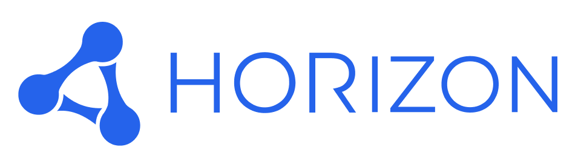

<p align="left">
  
</p>

# Horizon Agent Skills

Understand your Horizon Installation, design and build its configuration, operate Business Data, and improve its architecture—with portable [Agent Skills](https://agentskills.io) for your AI Agent.

## What you can do

Start with your goal. `horizon` connects to the selected Installation and coordinates the work; `horizon-interview` helps clarify requirements and required approvals when needed. For general modeling advice, you can invoke the guidance skill without connecting to an Installation.


**Built on current Horizon capabilities.** The CLI provides secure transport, Discovery supplies current contracts and authority, and humans review and publish Metadata proposals. Skills add workflow policy, safety, and continuity.

## Skills

| Skill | When to use it |
| --- | --- |
| [`horizon`](skills/horizon/SKILL.md) | Connect, select an Installation, route your request, and resume work. |
| [`horizon-interview`](skills/horizon-interview/SKILL.md) | Clarify complex requirements, agree on a plan, and settle required approvals. |
| [`horizon-ask-for-guidance`](skills/horizon-ask-for-guidance/SKILL.md) | Ask for read-only modeling advice, explanations of configured behavior, or help using the skills. Invoke this skill explicitly. |
| [`horizon-design`](skills/horizon-design/SKILL.md) | Prepare Metadata-only Design Briefs for external Dashboard or header design, export existing Widgets, and reconcile returned improvements. |
| [`horizon-metadata-authoring`](skills/horizon-metadata-authoring/SKILL.md) | Build data models, Pages, Dashboards, Widgets, and automation through a Workspace and human review. |
| [`horizon-runtime`](skills/horizon-runtime/SKILL.md) | Inspect Dashboards, work with Business Data, run Actions and Processes, handle assigned interactions, and configure or test Installation SMTP. |
| [`horizon-architecture-analysis`](skills/horizon-architecture-analysis/SKILL.md) | Audit Published Metadata, track architectural concerns, and verify implemented improvements. |

See [how the skill set is organized](docs/skill-set.md) for workflow ownership and detailed guidance.

## Automation guidance

Process work stays in the existing Data Modeling → Visualization → Automation workflow. The router selects authoring for definitions, triggers, summaries and Human Interaction orchestration, and runtime for authorized starts, inspection and assigned answers. Current Discovery supplies every executable contract and authority decision. Process proposal evidence uses the authoring skill’s Test scenarios; administrative controls without executable affordances and all Publication decisions go to an eligible human.

## Required setup

Horizon CLI is independent of any AI Harness. Horizon Skills work with Harnesses that support Agent Skills directly or through a compatible installer. Complete setup in this order.

1. Install Horizon CLI and verify `horizon version`.
2. Install Horizon Skills in your Harness.
3. Connect the CLI to a Horizon Installation.

### 1. Install Horizon CLI

macOS/Linux:

```sh
curl -fsSL https://platform.hrz.digital/cli/install.sh | sh
horizon version
```

Windows PowerShell:

```powershell
irm https://platform.hrz.digital/cli/install.ps1 | iex
horizon version
```

### 2. Install Horizon Skills

List available skills:

```bash
npx skills add hrz-digital/horizon-agent-skills --list
```

Install all skills globally:

```bash
npx skills add hrz-digital/horizon-agent-skills --skill '*' -g
```

#### Google Antigravity CLI

`npx skills` does not install Skills where Antigravity CLI can discover them. Create the required symlink:

```bash
ln -s ~/.agents/skills ~/.gemini/antigravity-cli/skills
```

### 3. Connect Horizon CLI to a Horizon Installation

1. Open the Account Sidebar in the target Horizon Installation.
2. Create an Agent Credential.
3. Copy the one-time **Connection Profile**.
4. Open a separate terminal outside the AI Harness.
5. Run the below command and paste the **Connection Profile** into the hidden prompt, and confirm it.

```bash
horizon connection add
```

6. Verify the Connection Profile:

```bash
horizon connection list --check
```

> [!WARNING]
> You must perform these steps yourself in a separate terminal. Never paste **Connection Profile** JSON or API keys into Agent chat or ask the Agent to run `horizon connection add`.

## Updating setup

Update Horizon CLI first, then update the Skill Set.

### Update Horizon CLI

Check whether a newer release is available:

```sh
horizon version --check
```

If an update is available, run the installer for your operating system.

macOS/Linux:

```sh
curl -fsSL https://platform.hrz.digital/cli/install.sh | sh
horizon version
```

Windows PowerShell:

```powershell
irm https://platform.hrz.digital/cli/install.ps1 | iex
horizon version
```

The installer resolves the latest release, verifies its checksum, and replaces the existing user-local executable. Stored Connection Profiles remain unchanged.

### Update Horizon Skills

Update installed Skills to latest published version:

```bash
npx skills update
```

Install this Skill Set at an exact version:

```bash
npx skills add https://github.com/hrz-digital/horizon-agent-skills/archive/refs/tags/v1.6.2.tar.gz --all -g
```

## Authentication

Horizon CLI provides the required authentication and transport boundary. It stores Agent Credential API keys in the operating-system credential store, exchanges short-lived tokens, and sends authenticated requests. API keys and tokens never belong in Harness storage, environment variables, prompts, skills, repositories, URLs, command arguments, output, or logs.

Skills verify CLI, list live-checked non-secret Connection Profiles, require explicit customer Installation choice, and pass selected profile on every request. Shared procedure lives in [`horizon`](skills/horizon/SKILL.md).

## Compatibility

Each workflow declares supported CLI and Discovery contract majors in frontmatter. Missing or unsupported CLI or Discovery major stops platform work; Skills never guess routes, schemas, payloads, or fall back to raw credential-bearing HTTP.
